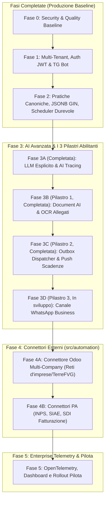

# SinfonIA — Cronoprogramma Evolutivo e Roadmap di Sviluppo

Il presente documento definisce la pianificazione dettagliata delle fasi di sviluppo di **SinfonIA**, integrando i **tre pilastri tecnologici abilitanti** (Document AI/OCR, Notifiche Push Proattive e Canale WhatsApp Business) e il layer di **integrazione verso gestionali esterni (Odoo Multi-Company per reti d'imprese e consorzi)**.

---

## 1. Quadro Generale delle Fasi

---

## 2. Stato delle Fasi Pregresse

| Fase | Titolo | Obiettivo | Stato | Documentazione |
| :--- | :--- | :--- | :--- | :--- |
| **Fase 0** | Baseline di Sicurezza e Qualità | Setup ESLint, Prettier, TypeScript strict, Secret scanner, CI | **COMPLETATA** | Commit `c928e0e` |
| **Fase 1** | Tenant Isolation & RBAC | Isolamento PostgreSQL con trigger, JWT HS256, ruoli, Telegram Client | **COMPLETATA** | Commit `40296c4` |
| **Fase 2** | Dominio Pratiche & Scheduler Durevole | Modello unificato `Practice`, payload JSONB, indici GIN, Advisory Locks, Outbox (sola scrittura), 4 Gate di validazione | **COMPLETATA** | [docs/FASI_1_E_2_REPORT.md](FASI_1_E_2_REPORT.md) |

### Stato della Fase 3 (verificato il 28/10/2026)

> **Attenzione alla numerazione**: i commit `315b8de` ("phase3c") e `3a75a9a` ("phase3d") e il [report di Fase 3](FASE_3_REPORT.md) usano le etichette 3C e 3D per **sicurezza dei prompt** ed **evaluation harness**, lavori non previsti da questo cronoprogramma. Il pilastro 3C (Push/Outbox) è stato realizzato con gli Step 5 e 6 dello [Stato Lavori](STATO_LAVORI_2026-10-28.md); il 3D (WhatsApp) è in sviluppo con lo Step 7.

| Fase (cronoprogramma) | Stato | Note |
| :--- | :--- | :--- |
| **3A** LLM esplicito & AI tracing | **COMPLETATA** | Tracce su database con conservazione, `/ai/traces` con filtri e paginazione (29/10/2026) |
| **3B** Document AI & OCR | **COMPLETATA (sviluppo)** | OCR reale in-process su foto e PDF, certificati, upload multipart, limiti di formato e dimensione, nessun valore inventato, storage S3/MinIO, conferma della pratica su Telegram (28/10/2026). Da fare: misura dell'accuratezza su documenti reali |
| **3C** Outbox dispatcher & push scadenze | **COMPLETATA (sviluppo)** | Dispatcher con retry e dead letter, consegna su Telegram e webhook (28/10/2026); scadenzario con promemoria a 30/15/7/1 giorni, API e comandi Telegram (29/10/2026). Da fare: prova con il bot reale in staging |
| **3D** WhatsApp Business | **COMPLETATA (sviluppo)** | Webhook con firma, collegamento con invito, conversazione comune a Telegram (test di parità), notifiche (29/10/2026). Da fare: template Meta con pulsanti e prova con un numero reale (richiedono la verifica Meta Business) |
| Extra: sicurezza prompt & PII | **COMPLETATA** | Pattern in italiano e su testo offuscato, nomi pseudonimizzati (Step 1, 29/10/2026) |
| Extra: evaluation harness | **COMPLETATA** | 61 scenari, gate sul modello reale (100% al 29/10/2026), job notturno (Step 2) |

Dettaglio completo: [AUDIT_ENTERPRISE_2026-10-28.md](AUDIT_ENTERPRISE_2026-10-28.md).

---

## 3. Fase 3: AI Avanzata & I 3 Pilastri Tecnologici

### Fase 3A: Finalizzazione Modalità LLM Esplicita, AI Tracing e Contesto
* **Obiettivo**: Garantire trasparenza e tracciabilità nei costi e nell'esecuzione dell'AI.
* **Componenti**:
  - `DisabledLLMClient` e gestione HTTP 503 con fallback deterministico trasparente.
  - `AITracer` per registrare latenza, consumo token, prompt/completion e audit per-tenant (`GET /ai/traces`).
  - Paginazione, ordinamento e ricerca keyword su `ContextService` per limitare il prompt token count.
* **Deliverable**: Chiusura linting, completamento test `tests/ai.phase3a.test.ts`.

---

### Fase 3B (Pilastro 1): Document AI, OCR & Gestione Allegati Multimodale
* **Obiettivo**: Consentire a soci, agricoltori e artigiani di inviare foto di fatture, ricevute, DDT o contratti PDF direttamente dallo smartphone, con estrazione automatica dei dati.
* **Architettura & Modifiche**:
  1. **Storage Documentale Isolato**:
     - Estensione di `prisma/schema.prisma` con tabella `practice_attachment`:
       - `id`, `tenant_id`, `practice_id`, `file_name`, `mime_type`, `file_size`, `storage_path`, `ocr_status`, `ocr_result`.
     - Adapter di storage locale e compatibilità S3/MinIO per conservazione sicura e multi-tenant.
  2. **Ricezione Media sui Canali di Messaggistica**:
     - Ricezione messaggi di tipo `photo` e `document` su Telegram (`src/interface/telegram`).
     - Ricezione webhook multipart e file binari sulle API REST Fastify (`POST /practices/:id/attachments`).
  3. **Motore OCR / Document AI Engine** (`src/ai/ocr/`):
     - Pipeline di estrazione:
       - Riconoscimento tipo documento (`Fattura fornitore`, `DDT / Bolla di consegna`, `Scontrino / Ricevuta`, `Certificato`).
       - Estrazione dati strutturati: Partita IVA fornitore, Data documento, Numero progressivo, Importo imponibile, Aliquote IVA, Totale documento, Voci di prodotto/lotti.
     - Schema di validazione Zod `InvoiceOcrSchema` e `DeliveryNoteOcrSchema`.
  4. **Aggiornamento Pratica**:
     - Arricchimento automatico del `payload` JSONB della pratica con i metadati estratti dall'OCR.
* **Test & Validazione**:
  - `tests/ocr.document.test.ts`: test su immagini e PDF campione (fattura, DDT, scontrino) con validazione dei campi estratti.

---

### Fase 3C (Pilastro 2): Scheduler Proattivo (Push) & Scadenzario Intelligente
* **Obiettivo**: Trasformare SinfonIA da sistema reattivo a **assistente attivo** che notifica in anticipo scadenze normative, bandi e promemoria per-tenant.
* **Architettura & Modifiche**:
  1. **Outbox Dispatcher Continuo** (`src/core/scheduler/outbox.dispatcher.ts`):
     - Background worker resiliente per la tabella `outbox_message`.
     - Politica di retry esponenziale, dead-letter status e transazionalità atomica.
     - Dispatcher verso i canali: invio messaggi Telegram, WhatsApp o webhook esterni.
  2. **Motore Scadenzario Multi-Tenant** (`src/core/compliance/`):
     - Modello `compliance_deadline`:
       - `id`, `tenant_id`, `user_id`, `category` (`DURC`, `SICUREZZA_LAVORO`, `CERTIFICAZIONE_BIO`, `VISITA_MEDICA`, `PATENTINO`), `due_date`, `notice_days`, `status`.
     - Job periodico dello scheduler (`CHECK_COMPLIANCE_DEADLINES`):
       - Calcola le scadenze a 30, 15, 7 e 1 giorno.
       - Genera notifiche mirate inserite nella coda `outbox_message`.
  3. **Notifiche Push Proattive su Smartphone**:
     - Recapito del messaggio formattato con avviso urgente e istruzioni per l'utente (es. *«Il tuo DURC scade tra 7 giorni. Clicca qui o invia il rinnovo»*).
* **Test & Validazione**:
  - `tests/compliance.scheduler.test.ts`: verifica che un record in scadenza generi esattamente un alert push senza duplicati.

---

### Fase 3D (Pilastro 3): Canale WhatsApp Business & Multi-Channel Engine
* **Obiettivo**: Consentire l'uso di SinfonIA su WhatsApp, canale primario per artigiani (ConfArtigianato) e produttori agricoli (TerreFVG).
* **Architettura & Modifiche**:
  1. **WhatsApp Adapter & Webhook** (`src/interface/whatsapp/`):
     - Integrazione con Meta WhatsApp Cloud API (Graph API).
     - Endpoint Fastify:
       - `GET /webhooks/whatsapp`: verifica del webhook (challenge token).
       - `POST /webhooks/whatsapp`: ricezione messaggi testuali, immagini, documenti e coordinate geografiche.
  2. **Riconoscimento Identità Telefonica Sicura**:
     - Tabella `whatsapp_identity`: mapping `phone_number` $\rightarrow$ `user_id` $\rightarrow$ `tenant_id`.
     - Associazione con codice invito (`/start <codice-invito>` anche su WhatsApp tramite messaggio iniziale).
  3. **Parità Funzionale con Telegram e REST**:
     - L'adapter inoltra le richieste all'interprete semantico e al `PracticeApplicationService` senza differenze di comportamento rispetto a Telegram.
  4. **Supporto Template Interattivi di Meta**:
     - Invio di messaggi con pulsanti di azione rapida (*«Approva pratica»*, *«Visualizza dettagli»*, *«Invia documento»*).
* **Test & Validazione**:
  - `tests/whatsapp.adapter.test.ts`: test mock del webhook Meta, ricezione messaggi/media e verifica invio template.

---

## 4. Fase 4: Integrazione e Layer di Automazione (`src/automation`)

### Fase 4A: Connettore Odoo Multi-Company (Reti d'Imprese / TerreFVG)
* **Obiettivo**: Gestione centralizzata su un unico Odoo condiviso con segregazione per singola azienda retista.
* **Architettura & Modifiche**:
  1. **Modulo Odoo Adapter** (`src/automation/odoo/`):
     - Client JSON-RPC / REST verso l'istanza Odoo centrale.
     - Configurazione Tenant: memorizzazione in `tenant.integration_config` dei parametri `odoo_company_id`, database, credenziali API.
  2. **Sincronizzazione Bidirezionale**:
     - **Fatture Fornitori / Note Spesa**: creazione record `account.move` (`in_invoice`) con righe contabili e allegato PDF/immagine associato (`ir.attachment`).
     - **Bolle di Consegna (DDT)**: creazione record di movimento magazzino (`stock.picking` o documento di trasporto).
     - **Anagrafiche**: verifica o creazione del partner (`res.partner`) basato su Codice Fiscale / Partita IVA del socio.
  3. **Aggiornamento di Stato**:
     - Ritorno dell'ID contabile Odoo salvato nel payload della pratica SinfonIA; cambio stato in `COMPLETED`.

---

### Fase 4B: Connettori PA e Servizi di Categoria
* **Obiettivo**: Integrazione diretta con gli enti pubblici e previdenziali per eliminare la burocrazia manuale.
* **Moduli**:
  - **INPS / ex-ENPALS** (per cooperative musicali): trasmissione telematica delle richieste di agibilità prima dello spettacolo.
  - **SIAE** (per artisti): invio borderò e programma musicale digitale.
  - **Fatturazione Elettronica SDI** (per cooperative e consorzi): emissione e ricezione file XML fattura con notifica automatica.

---

## 5. Fase 5: Monitoraggio Enterprise, Telemetria & Rollout Pilota

* **Telemetria OpenTelemetry & Metriche Prometheus**:
  - Metriche su latenza chiamate AI, percentuali di successo OCR, tempi di risposta Odoo, job scheduler eseguiti.
* **Dashboard Operativa di Rete**:
  - Interfaccia web leggera per i funzionari di rete/consorzio per monitorare lo stato di salute dei tenant e l'avanzamento pratiche.
* **Rollout Pilota**:
  - Test operativo sul campo con 2-3 aziende di una rete pilota (es. TerreFVG o cooperativa di spettacolo) prima dell'estensione a tutti gli associati.

---

## 6. Matrice Riassuntiva delle Fasi di Sviluppo Rimanenti

| Fase | Denominazione | Risultato Chiave | Dipendenze |
| :--- | :--- | :--- | :--- |
| **3A** | **LLM Esplicito & AI Tracing** | Tracciamento costi/token, chiusura 3 errori lint, fallback 503 | Fase 2 |
| **3B** | **Pilastro 1: Document AI & OCR** | Caricamento foto/PDF, estrazione dati fatture e DDT in payload | Fase 3A |
| **3C** | **Pilastro 2: Push Scadenze & Outbox** | Outbox worker continuo, alert proattivi scadenze normative | Fase 3B |
| **3D** | **Pilastro 3: Canale WhatsApp Business** | Webhook Meta Cloud API, parità Telegram, pulsanti interattivi | Fase 3C |
| **4A** | **Connettore Odoo Multi-Company** | Integrazione automatica DDT/Fatture su Odoo per singola azienda | Fase 3B, 3C |
| **4B** | **Connettori PA (INPS, SIAE, SDI)** | Agibilità telematiche e fatturazione elettronica | Fase 4A |
| **5** | **Hardening & Rollout Pilota** | Telemetria OpenTelemetry, audit di carico e rollout su rete reale | Fase 4B |
