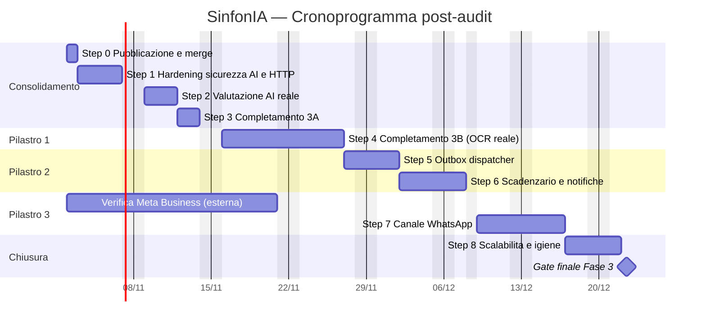

# SinfonIA — Stato dei lavori dopo l'audit

**Data**: 28/10/2026
**Branch**: `fix/p0-audit-remediation` · **Commit**: `c1e6c6b` (base: `main` locale `4f2b1f3`)
**Riferimento**: [AUDIT_ENTERPRISE_2026-10-28.md](AUDIT_ENTERPRISE_2026-10-28.md)

---

## 1. In sintesi

- L'audit enterprise ha classificato ogni funzionalità come funzionante, parziale, difettosa, pianificata o assente.
- I **4 interventi P0** emersi dall'audit sono stati **completati e committati** in locale.
- Tutti i quality gate della CI passano in locale.
- **Non pubblicato**: il push su GitHub è bloccato da un problema di permessi (§7) ed è stato rimandato.
- Restano aperti gli interventi **P1** e **P2** (§4).
- Rispetto al piano della Fase 3: 3A completa, 3B parziale (manca l'OCR reale), 3C e 3D non iniziate (§5).
- Il cronoprogramma per step (§6) porta a chiudere la Fase 3 in 36 giornate lavorative: gate finale il 22/12/2026, metà gennaio 2027 con margine.
- **Aggiornamento 28/10/2026 — Step 4 completato nello sviluppo**: OCR reale, storage S3/MinIO e conferma della pratica su Telegram implementati e testati (§6.3, Step 4). Resta la prova su documenti reali.

---

## 2. Interventi P0 completati

| # | Intervento | File principali | Verifica |
| :- | :--- | :--- | :--- |
| 1 | **CI di nuovo verde**: riformattati con Prettier i 4 file che facevano fallire `format:check` | `src/ai/evaluation/*.ts`, `scripts/run-eval.ts` | `npm run format:check` ✅ |
| 2 | **Advisory lock senza perdite**: il lock di sessione (acquisito e rilasciato su connessioni del pool potenzialmente diverse) è sostituito da `pg_try_advisory_xact_lock` in una transazione dedicata, rilasciato da PostgreSQL a commit/rollback. Timeout massimo 5 minuti | `src/data/repositories/scheduler.repository.ts` | Test di regressione dedicato ✅ |
| 3 | **Export schedulato tenant-wide**: include le pratiche di tutti gli utenti del tenant, non solo quelle del primo amministratore | `src/core/scheduler/scheduler.service.ts` | Test di regressione dedicato ✅ |
| 4 | **Documentazione allineata al codice**: rimosse o corrette le affermazioni non vere (OCR, eval, PII, outbox, numerazione fasi, nomi di file, stati FSM, claim JWT) | `README.md`, `docs/FASE_3_REPORT.md`, `docs/FASI_1_E_2_REPORT.md`, `docs/DATA_RESIDENCY_AND_GDPR.md`, `docs/CRONOPROGRAMMA_EVOLUTIVO.md` | Revisione manuale |

### Test di regressione aggiunti (`tests/scheduler.test.ts`)

- `never leaks the advisory lock on pooled connections or on failure`
- `exports practices of every tenant user, not only the admin`

Entrambi sono stati eseguiti anche sul codice precedente alla correzione e **fallivano** sui due difetti (lock trattenuto; 1 pratica esportata su 2). Con la correzione passano. Il test esistente sulla concorrenza tra due worker è stato riscritto sulla nuova API `withAdvisoryLock`.

---

## 3. Quality gate (eseguiti in locale il 28/10/2026)

| Controllo | Prima degli interventi | Dopo |
| :--- | :---: | :---: |
| `npm run typecheck` | ✅ | ✅ |
| `npm run lint` | ✅ | ✅ |
| `npm run format:check` | ❌ 4 file | ✅ |
| `npm run secret:scan` | ✅ | ✅ |
| `npm test` (PostgreSQL 17, porta 5433) | ✅ 100/100 | ✅ **102/102** |
| `npm run build` | ✅ | ✅ |
| `npm audit --omit=dev` | ✅ 0 vulnerabilità | non rieseguito (dipendenze invariate) |

Non eseguito: `npm run ai:eval:nightly` (chiamate a pagamento al modello OpenAI reale).

---

## 4. Stato delle funzionalità e lavoro residuo

### 4.1 Stato attuale per area

| Area | Stato |
| :--- | :--- |
| Multi-tenancy, autenticazione JWT, RBAC, audit log, macchina a stati, API pratiche, bot Telegram | 🟢 Funzionante |
| Scheduler durevole (idempotenza, lock, export) | 🟢 Funzionante dopo le correzioni P0 |
| Outbox | 🟢 Dispatcher con retry, dead letter e consegna su Telegram e webhook firmato (aggiornato 28/10/2026, Step 5; prima: 🟡 solo scrittura) |
| Interprete LLM, fallback deterministico, richieste di chiarimento | 🟢 Funzionante, validato solo con stub |
| Difesa prompt injection e minimizzazione PII | 🟡 Parziale: pattern limitati, nomi non pseudonimizzati |
| Allegati e OCR | 🟢 OCR reale in-process su foto e PDF, upload multipart, limiti di formato e dimensione (aggiornato 28/10/2026; prima: 🔴 nessun OCR reale) |
| Evaluation harness | 🟡 Infrastruttura presente, in CI usa un LLM simulato |
| Push/scadenzario, WhatsApp, Odoo, connettori PA, telemetria, dashboard | 🔵 Non iniziati |

### 4.2 Interventi P1 (prossimi)

| Intervento | Effort indicativo |
| :--- | :--- |
| OCR reale (modello vision o servizio Document AI con residenza UE) dietro `DocumentOcrService`, con whitelist MIME e limiti di dimensione | 3–5 g |
| Outbox dispatcher con retry esponenziale e dead-letter | 2–3 g |
| Eval con modello reale schedulata in CI e golden set ampliato (parafrasi, italiano, injection non banali) | 2 g |
| Pseudonimizzazione dei nomi nel contesto LLM, oppure base giuridica e DPA espliciti; provider UE configurabile (Azure OpenAI) | 2–3 g |
| Rate limiting e security headers (`@fastify/rate-limit`, `@fastify/helmet`) | 0,5 g |

### 4.3 Interventi P2

- Paginazione/streaming per export e contesto AI (oggi caricano tutte le pratiche in memoria).
- Tracer AI persistente e filtri esposti su `GET /ai/traces`.
- Memoria conversazionale Telegram su DB/Redis; conferma esplicita della pratica a cui associare un allegato.
- Separare lo scheduler dal DB watcher; ripulire i log diagnostici di avvio; pulire `dist/` prima della build.
- Flusso di autenticazione per utenti finali (oggi i token si generano solo da CLI).

---

## 5. Confronto con il piano della Fase 3

Confronto tra la pianificazione della Fase 3 in [CRONOPROGRAMMA_EVOLUTIVO.md](CRONOPROGRAMMA_EVOLUTIVO.md) (§3) e il codice al commit `c1e6c6b`.

Legenda: ✅ fatto · 🟡 parziale · 🔴 presente ma non funzionante sul caso d'uso · ⚫ assente

**Sintesi**: la 3A è completa, la 3B è a metà (manca il motore OCR reale), la 3C e la 3D non sono iniziate. Sono stati fatti lavori non previsti dal piano (§5.5).

### 5.1 Fase 3A — LLM esplicito, tracing e contesto: **completata**

| Previsto | Stato reale |
| :--- | :--- |
| `DisabledLLMClient` + HTTP 503 con fallback deterministico | ✅ Fatto e testato |
| `AITracer` con latenza, token, prompt/completion, audit per tenant, `GET /ai/traces` | 🟡 Registra latenza, token ed esito per tenant. Non salva il testo di prompt e completion (scelta coerente con il GDPR, ma diversa dal piano). Tracce solo in memoria; filtri non esposti dall'endpoint |
| Paginazione, ordinamento e ricerca su `ContextService` | ✅ Presenti; le pratiche vengono però caricate tutte e tagliate in memoria |
| Deliverable: lint pulito, `tests/ai.phase3a.test.ts` | ✅ |

### 5.2 Fase 3B (Pilastro 1) — Document AI e OCR: **parziale**

| Previsto | Stato reale |
| :--- | :--- |
| Tabella `practice_attachment` con i campi previsti | ✅ Fatta (con in più lo stato `PROCESSING`) |
| Storage locale + S3/MinIO | 🟡 Solo storage locale |
| Ricezione `photo`/`document` su Telegram | ✅ Funziona; il file viene associato all'ultima pratica senza conferma |
| Upload multipart e binario su `POST /practices/:id/attachments` | 🟡 Solo JSON con contenuto base64, fino a circa 750 KB |
| Motore OCR: tipo documento ed estrazione di P.IVA, data, numero, imponibile, aliquote, totale, righe | 🔴 Classificazione ed estrazione funzionano solo su file già testuali. Nessun OCR né modello vision: foto e PDF reali non producono dati |
| Tipi: fattura, DDT, scontrino, certificato | 🟡 Fattura, DDT, scontrino, generico; **certificato assente** |
| Schemi Zod `InvoiceOcrSchema`, `DeliveryNoteOcrSchema` | ✅ Presenti, più `ReceiptOcrSchema` |
| Arricchimento del `payload` della pratica | ✅ Funziona quando l'estrazione produce dati |
| Test su immagini e PDF campione | 🔴 I test usano solo testo semplice |

### 5.3 Fase 3C (Pilastro 2) — Push e scadenzario: **non iniziata**

| Previsto | Stato reale |
| :--- | :--- |
| `outbox.dispatcher.ts` con retry esponenziale, dead-letter, consegna su Telegram/WhatsApp/webhook | ✅ Telegram e webhook (Step 5, 28/10/2026); WhatsApp con lo Step 7 |
| Modello `compliance_deadline` e `src/core/compliance/` | ⚫ Assenti |
| Job `CHECK_COMPLIANCE_DEADLINES` (avvisi a 30/15/7/1 giorni) | ⚫ Assente; lo scheduler gestisce un solo tipo di task (`EXPORT_PRACTICES`) |
| Notifiche push all'utente | ⚫ Assenti |
| `tests/compliance.scheduler.test.ts` | ⚫ Assente |

Basi già pronte: scheduler idempotente con lock corretto (P0) e dispatcher dell'outbox (Step 5).

### 5.4 Fase 3D (Pilastro 3) — WhatsApp Business: **non iniziata**

| Previsto | Stato reale |
| :--- | :--- |
| `src/interface/whatsapp/`, webhook Meta `GET`/`POST /webhooks/whatsapp` | ⚫ Assenti |
| Tabella `whatsapp_identity` + collegamento con codice invito | ⚫ Assenti (il binding Telegram è un modello riutilizzabile) |
| Parità di comportamento con Telegram e REST | ⚫ Favorita dall'architettura: tutto passa da `PracticeApplicationService` e dall'interprete |
| Template interattivi con pulsanti | ⚫ Assenti |
| `tests/whatsapp.adapter.test.ts` | ⚫ Assente |

### 5.5 Lavoro realizzato ma non previsto dal piano

I commit etichettati "phase3c" e "phase3d" hanno realizzato attività diverse da quelle del piano, da cui la sovrapposizione di numerazione:

| Attività | Stato |
| :--- | :--- |
| Sicurezza prompt: delimitazione `<user_input>`, escaping, `PromptGuard` a pattern | 🟡 Attiva; pattern limitati e prevalentemente in inglese |
| Minimizzazione PII: CF, IBAN, carte, email, telefono | 🟡 Attiva; nomi e cognomi non mascherati |
| Evaluation harness + golden set di 19 scenari | 🟡 In CI usa un LLM simulato; esecuzione con modello reale non schedulata |
| Correzioni P0 post-audit (lock, export, CI, documentazione) | ✅ Completate (§2) |

---

## 6. Cronoprogramma di sviluppo per step

### 6.1 Ipotesi

- **Perimetro**: completamento di tutto ciò che è parziale (3A, 3B, sicurezza, valutazione AI), realizzazione dei pilastri non iniziati (3C, 3D) e consolidamento P2. Le Fasi 4 e 5 restano come da cronoprogramma evolutivo (§6.5).
- **Risorse**: 1 sviluppatore a tempo pieno; giorni lavorativi, esclusi weekend e festivi (8 dicembre, pausa natalizia).
- **Inizio**: lunedì 2 novembre 2026.
- **Stime** senza margine: per un piano realistico aggiungere circa il 20% (≈ 7 giorni).
- **Regola di uscita per ogni step**: typecheck, lint, format, test e build verdi in CI; nuovi test che coprono i criteri di accettazione; documentazione aggiornata.

### 6.2 Vista d'insieme

| Step | Contenuto | Effort | Date | Dipende da | Milestone |
| :--- | :--- | :---: | :--- | :--- | :--- |
| 0 | Pubblicazione e merge | 1 g | 2 nov | — | CI verde su GitHub |
| 1 | Hardening sicurezza AI e HTTP | 4 g | 3–6 nov | 0 | **M1** Sicurezza |
| 2 | Valutazione AI con modello reale | 3 g | 9–11 nov | 1 | |
| 3 | Completamento 3A | 2 g | 12–13 nov | 0 | **M2** 3A chiusa |
| 4 | Completamento 3B — OCR reale | 9 g | 16–26 nov | 1 | **M3** Pilastro 1 |
| 5 | Outbox dispatcher | 3 g | 27 nov–1 dic | 0 | |
| 6 | Scadenzario e notifiche | 4 g | 2–7 dic | 5 | **M4** Pilastro 2 |
| 7 | Canale WhatsApp | 6 g | 9–16 dic | 4, 5, verifica Meta | **M5** Pilastro 3 |
| 8 | Scalabilità e igiene | 3 g | 17–21 dic | — | |
| — | Gate finale Fase 3 | 1 g | 22 dic | 1–8 | **M6** Fase 3 chiusa |
| | **Totale** | **36 g** | | | Con margine del 20%: metà gennaio 2027 |

### 6.3 Dettaglio degli step

#### Step 0 — Pubblicazione e merge (1 g)
- Ottenere i permessi di scrittura su `Sinfoni4/SinfonIA` per `Flv72S` (§7.1).
- Pubblicare il `main` locale (9 commit di Fase 2B–3 non ancora su GitHub), poi aprire la PR di `fix/p0-audit-remediation` con la sola correzione P0.
- Avviare subito la **verifica Meta Business** e la richiesta del numero WhatsApp: hanno tempi esterni di 1–3 settimane.
- **Accettazione**: CI verde su GitHub, PR P0 unita a `main`.

#### Step 1 — Hardening sicurezza AI e HTTP (4 g) · completa le attività aggiunte
- Rate limiting per utente e tenant (`@fastify/rate-limit`), con limite più stretto su `/ai/execute`; security headers (`@fastify/helmet`).
- Pseudonimizzazione di nomi e cognomi nell'input e nei nomi pratica del contesto, con ripristino locale (estensione di `PiiMinimizer`).
- `PromptGuard`: pattern in italiano e varianti comuni (parafrasi, spaziature, codifiche).
- Provider LLM configurabile (OpenAI / Azure OpenAI in regione UE) tramite variabili d'ambiente.
- **Accettazione**: nessun nome in chiaro nel prompt inviato al provider (test); 429 oltre la soglia; injection in italiano bloccate.

#### Step 2 — Valutazione AI con modello reale (3 g) · completa le attività aggiunte
- Golden set ampliato da 19 ad almeno 60 scenari: parafrasi in italiano, input con errori, ambiguità reali, injection non banali, PII miste.
- Job CI notturno (`ai:eval:nightly`) con chiave in GitHub Secrets e budget di costo; report salvato come artifact.
- Separare nei report i risultati "pipeline" (LLM simulato) da quelli "modello" (LLM reale).
- **Accettazione**: metriche reali documentate; soglie (success ≥ 95%, wrong execution 0%, injection block 100%) applicate al run reale.

#### Step 3 — Completamento 3A (2 g)
- Tracer persistente: tabella `ai_trace` (migrazione), retention configurabile, nessun testo di prompt salvato.
- `GET /ai/traces` con filtri `outcome`, `from`, `to`, `limit` e paginazione.
- `ContextService` e `listPractices` con limite applicato dal database invece che in memoria.
- **Accettazione**: tracce conservate dopo un riavvio; filtri testati; query di contesto con `LIMIT` verificata.

#### Step 4 — Completamento 3B: OCR reale (9 g) · Pilastro 1
- Motore OCR reale dietro `DocumentOcrService`: servizio Document AI o modello vision con residenza dei dati UE (4 g).
- Upload multipart su `POST /practices/:id/attachments` (`@fastify/multipart`), whitelist MIME (JPEG, PNG, PDF), limite di dimensione configurabile (1 g).
- Tipo documento `certificate` con schema Zod dedicato (0,5 g).
- Adapter di storage S3/MinIO accanto a quello locale; controllo path traversal con separatore (1,5 g).
- Telegram: conferma esplicita della pratica a cui associare il file, con scelta se ce n'è più d'una (1 g).
- Test con fixture reali anonimizzate: foto di fattura, PDF di DDT, scontrino, certificato (1 g).
- **Accettazione**: dalla foto di una fattura si estraggono P.IVA, data, numero e totale con l'accuratezza target concordata; file oltre il limite o con MIME non ammesso rifiutati.

**Avanzamento al 28/10/2026**

| Sotto-attività | Stato | Note |
| :--- | :---: | :--- |
| Motore OCR reale | ✅ | Tesseract in-process con modello italiano incluso nelle dipendenze; nessun dato verso terzi e nessun costo per documento. Scelto al posto di un servizio cloud per i vincoli GDPR; l'interfaccia `OcrEngine` permette di aggiungerne uno in seguito |
| PDF digitali e scansionati | ✅ | Testo letto dal PDF; se assente, pagine rasterizzate (max 5) e passate all'OCR |
| Nessun valore inventato | ✅ | Campi non letti a `null` + `missingFields`, `warnings` (P.IVA, totali, confidenza) e `reviewRequired`. Corretto un difetto non rilevato dall'audit: il parser inseriva valori fittizi |
| Upload multipart, whitelist formati, limite dimensione | ✅ | Formato rilevato dai magic bytes; `ATTACHMENT_MAX_BYTES` (default 10 MB); errori 413/415 |
| Tipo `certificate` | ✅ | Categoria (BIO, DURC, ...) e data di scadenza, già pronti per lo scadenzario dello Step 6 |
| Risposta Telegram | ✅ | Riepilogo dei dati letti e dei campi da verificare; file troppo grandi rifiutati prima del download |
| Fixture e test | ✅ | 7 documenti fittizi in `tests/fixtures/ocr/` (foto inclinate con rumore, PDF digitale, PDF scansionato); 23 nuovi test; suite completa 125/125 |
| Adapter S3/MinIO | ✅ | `STORAGE_DRIVER=s3`: chiavi per tenant (`<tenant>/attachments/...`), lettura e cancellazione solo nel prefisso del tenant, cifratura lato server opzionale, regione predefinita `eu-south-1` (Milano). Testato con client simulato; non ancora provato contro un MinIO reale |
| Conferma della pratica su Telegram | ✅ | Con una sola pratica aperta il file viene associato direttamente; se la didascalia nomina una pratica, si usa quella; altrimenti il bot chiede di scegliere tra le ultime 5 (risposta con il numero o "annulla", validità 10 minuti) |
| Path traversal dello storage locale | ✅ | Corretto il controllo con prefisso senza separatore segnalato nell'audit |
| Prova su documenti reali | ⏳ | Le fixture sono generate e pulite: va misurata l'accuratezza su foto reali anonimizzate prima del pilota. Pronti il protocollo ([PROTOCOLLO_PROVA_OCR.md](PROTOCOLLO_PROVA_OCR.md)) e lo script `npm run ocr:accuracy`; servono i documenti della cooperativa |

**CI su GitHub (28/10/2026)**: alla prima pubblicazione la pipeline falliva già all'installazione delle dipendenze, su tutti i branch: due binari solo Windows erano dipendenze dirette (da `643f298`) e il lockfile, generato con npm 11, non era accettato dall'npm 10 della CI. Corretti entrambi: CI verde su GitHub Actions.

Note: l'OCR è sincrono nella richiesta (0,3–3 s per documento sulle fixture); con lo Step 5 potrà passare in coda asincrona.

#### Step 5 — Outbox dispatcher (3 g) · Pilastro 2, prerequisito anche del 3
- Worker `src/core/scheduler/outbox.dispatcher.ts`: lettura con `FOR UPDATE SKIP LOCKED`, retry esponenziale, stato `DEAD_LETTER` (migrazione con `attempts`, `next_attempt_at`).
- Adapter di canale: Telegram e webhook esterno (WhatsApp si aggiunge allo Step 7).
- Consegna degli export schedulati oggi rimasti in `PENDING`.
- Separare lo scheduler e il dispatcher dal DB watcher.
- **Accettazione**: nessun messaggio consegnato due volte con due worker in parallelo; messaggio in dead-letter dopo N tentativi falliti.

**Avanzamento al 28/10/2026**

| Sotto-attività | Stato | Note |
| :--- | :---: | :--- |
| Dispatcher | ✅ | `src/core/outbox/outbox.dispatcher.ts` (in una cartella propria invece che in `scheduler/`). Presa in carico con `FOR UPDATE SKIP LOCKED` e lease di 5 minuti: il lease viene rinnovato prima di ogni messaggio, quindi anche l'ultimo di un gruppo lento ha 5 minuti pieni; un messaggio di un worker caduto torna disponibile alla scadenza; gli aggiornamenti tardivi del worker caduto vengono ignorati (`claim_token` cambia a ogni presa in carico, anche dopo una rimessa in coda). Un errore su un messaggio non blocca gli altri del gruppo |
| Retry e dead letter | ✅ | Backoff esponenziale 30 s → 1 h con jitter ±20%, rispetta `retry_after`/`Retry-After` entro lo stesso tetto di 1 h; `DEAD_LETTER` dopo `OUTBOX_MAX_ATTEMPTS` (default 8) o subito per errori permanenti (chat inesistente, bot bloccato, 4xx del webhook). Messaggi senza destinatari o di tipo sconosciuto in dead letter, non persi in silenzio; se il bot Telegram non è configurato si ritenta invece di scartare. `requeueDeadLetter` per rimetterli in coda |
| Nessun doppio invio | ✅ | Ogni destinatario consegnato viene registrato (`delivered_targets`): un nuovo tentativo invia solo ai destinatari mancanti. Garanzia "almeno una volta" per destinatario; il webhook riceve un id stabile (`x-sinfonia-delivery`) per deduplicare |
| Canale Telegram | ✅ | L'export arriva come file CSV a ogni ADMIN del tenant collegato a Telegram (`sendDocument`); ogni chiamata al Bot API ha un timeout (30 s, 60 s per i download) |
| Canale webhook | ✅ | URL per tenant (`tenant.webhook_url`), solo HTTPS in produzione, firma HMAC-SHA256 su timestamp + corpo, timeout 10 s. In produzione rifiutati gli indirizzi di rete interna (loopback, privati, link-local come i metadata cloud); un reindirizzamento è un errore definitivo da correggere nella configurazione. Senza `OUTBOX_WEBHOOK_SECRET` i webhook vanno in dead letter invece di partire non firmati |
| Export rimasti in `PENDING` | ✅ | La migrazione li rende subito consegnabili |
| Worker separati dal DB watcher | ✅ | `src/runtime/runtime.workers.ts`: scheduler (`SCHEDULER_INTERVAL_MS`, default 60 s) e dispatcher (`OUTBOX_DISPATCH_INTERVAL_MS`, default 5 s) su intervalli propri, senza sovrapposizioni, fermi a circuito aperto, attesi allo shutdown |
| Test | ✅ | 34 nuovi test (`tests/outbox.dispatcher.test.ts`, `tests/runtime.workers.test.ts`). Il test con due dispatcher in parallelo fallisce se si toglie il lock di riga; quelli su lease e token falliscono senza le rispettive correzioni |
| Revisione del codice | ✅ | Corretti gli 8 punti emersi dalla revisione della PR #2 (timeout Telegram, lease per messaggio, isolamento degli errori, token di presa in carico, redirect, tetto al retry-after, bot non configurato, indirizzi interni) |
| Prova con Telegram reale | ⏳ | I canali sono testati con client simulati; da verificare con il bot reale in staging |
| API per configurare il webhook del tenant e per rivedere la dead letter | ⏳ | Oggi `webhook_url` si imposta sul database e i messaggi si rimettono in coda da codice; da esporre in un'API amministrativa |

#### Step 6 — Scadenzario e notifiche (4 g) · Pilastro 2
- Modello `compliance_deadline` (categorie `DURC`, `SICUREZZA_LAVORO`, `CERTIFICAZIONE_BIO`, `VISITA_MEDICA`, `PATENTINO`) e servizio in `src/core/compliance/`.
- API REST e comandi Telegram per creare, elencare e chiudere le scadenze.
- Registro dei task dello scheduler estendibile; nuovo job `CHECK_COMPLIANCE_DEADLINES` con avvisi a 30/15/7/1 giorni, idempotenti per scadenza e soglia.
- Messaggi di notifica formattati, accodati in outbox e consegnati dallo Step 5.
- **Accettazione**: `tests/compliance.scheduler.test.ts` — una scadenza genera esattamente un avviso per soglia, anche con tick ripetuti e due worker.

#### Step 7 — Canale WhatsApp (6 g) · Pilastro 3
- `src/interface/whatsapp/`: webhook Meta `GET` (challenge) e `POST` con verifica della firma `X-Hub-Signature-256`.
- Tabella `whatsapp_identity` (telefono → utente → tenant) e collegamento con codice invito.
- Adapter con parità di comportamento rispetto a Telegram: interprete, comandi deterministici, allegati verso lo Step 4.
- Template interattivi Meta con pulsanti («Approva pratica», «Visualizza dettagli», «Invia documento»).
- Canale WhatsApp nel dispatcher outbox, per ricevere anche le notifiche di scadenza.
- **Accettazione**: `tests/whatsapp.adapter.test.ts` con webhook simulato (testo, immagine, documento, firma non valida rifiutata); test di parità con Telegram.

#### Step 8 — Scalabilità e igiene (3 g) · P2
- Export in streaming o paginato invece del caricamento completo in memoria.
- Memoria conversazionale di Telegram (e WhatsApp) su database.
- Rimozione dei log diagnostici di avvio; logger strutturato ovunque; pulizia di `dist/` prima della build; process lock adatto alla produzione.
- **Accettazione**: export di 10.000 pratiche entro una soglia di memoria definita; nessun `console.log` nel codice di produzione.

#### Gate finale Fase 3 (1 g)
- Esecuzione completa: CI, eval notturno reale, test di carico leggero, aggiornamento di report e cronoprogramma.
- **Accettazione**: tutte le righe delle tabelle §5.1–§5.5 in stato ✅.

### 6.4 Rischi principali

| Rischio | Impatto | Mitigazione |
| :--- | :--- | :--- |
| Approvazione Meta (Business, numero, template) più lenta del previsto | Ritardo dello Step 7 | Avvio allo Step 0; Step 8 anticipabile al suo posto |
| Accuratezza OCR insufficiente su foto da smartphone | Pilastro 1 non utilizzabile | Prova comparativa di 2 servizi su fixture reali nei primi 2 giorni dello Step 4 |
| Costi del modello reale (eval notturno, OCR vision) | Budget | Limiti di spesa, campionamento, modello economico per l'eval |
| Vincoli GDPR sull'OCR e sull'LLM | Blocco del rilascio | Provider UE dallo Step 1; DPA con i fornitori prima del pilota |
| Unico sviluppatore | Nessuna parallelizzazione | Con 2 persone, Step 5–6 possono procedere in parallelo allo Step 4 (≈ −1,5 settimane) |

### 6.5 Dopo la Fase 3

Restano invariate rispetto al [cronoprogramma evolutivo](CRONOPROGRAMMA_EVOLUTIVO.md): **Fase 4A** connettore Odoo multi-company, **Fase 4B** connettori PA (INPS/ex-ENPALS, SIAE, SDI), **Fase 5** telemetria OpenTelemetry, dashboard di rete e rollout pilota. Da pianificare anche il flusso di autenticazione per utenti finali (oggi i token si generano solo da CLI), necessario prima della dashboard.

---

## 7. Operazioni in sospeso

### 7.1 Pubblicazione su GitHub — rimandata

- Il push di `fix/p0-audit-remediation` su `Sinfoni4/SinfonIA` è stato rifiutato con **HTTP 403**: l'account autenticato `Flv72S` ha solo permesso di lettura. Non risultano inviti da collaboratore in attesa.
- Il 28/10/2026 il repository è stato ricreato vuoto (pubblico); l'account `Flv72S` risulta ancora con permesso READ.
- Per sbloccare: dall'account `Sinfoni4`, *Settings → Collaborators → Add people* → `Flv72S` con ruolo Write, poi accettare l'invito. In alternativa si può aprire la PR da un fork pubblico sotto `Flv72S`.
- **Attenzione**: su GitHub `main` è fermo a `44d419a` (Fase 2A). Una PR da questo branch conterrà anche i 9 commit locali di Fase 2B–3 non ancora pubblicati, oltre alla correzione P0. Se si vuole una PR con la sola correzione, va prima pubblicato il `main` locale.

### 7.2 Altro

- Il branch `fix/p0-audit-remediation` non è ancora stato unito a `main` locale.
- I file `.env` e `.env.test` locali contengono chiavi reali (OpenAI, Telegram). Sono esclusi da Git, ma gli harness `npm run ai:test*` le usano per chiamare OpenAI.
